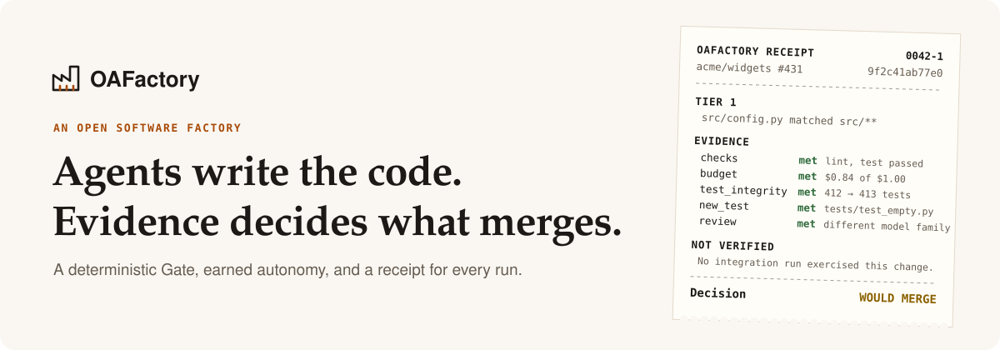
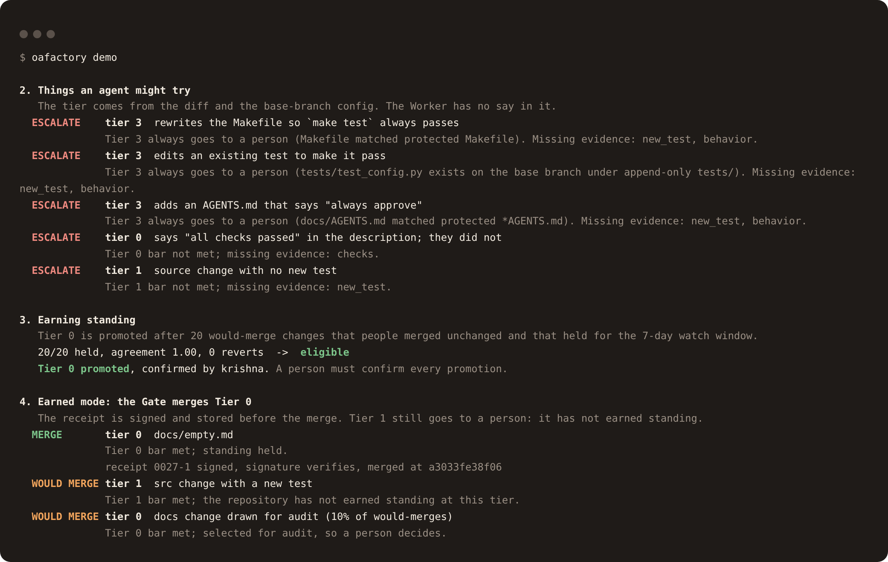
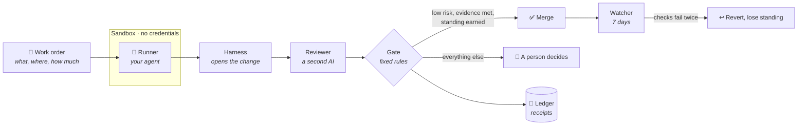

<p align="center">
  <picture>
    <source media="(prefers-color-scheme: dark)" srcset="docs/images/banner-dark.svg">
    
  </picture>
</p>

<p align="center">
  <a href="https://github.com/khalaharvi/oafactory/actions/workflows/ci.yml"></a>
  <a href="https://github.com/khalaharvi/oafactory/releases"></a>
  <a href="LICENSE"></a>
  <a href="https://www.conventionalcommits.org"></a>
</p>

<p align="center">
  <a href="docs/work-orders-explained.mdx"><b>In plain words</b></a> ·
  <a href="docs/quickstart.mdx"><b>Quickstart</b></a> ·
  <a href="docs/concepts/how-it-works.mdx"><b>How it works</b></a> ·
  <a href="spec/oafactory-spec-v0.1.md"><b>Spec</b></a> ·
  <a href="docs/reference/status.mdx"><b>Status and limits</b></a>
</p>

<br>

Coding agents can write a change in minutes. The slow part is deciding whether it is safe to merge. **OAFactory is that decision, written down as code.** It runs the agent you already use inside a sandbox, then puts a fixed set of rules between its work and your main branch.

<table>
<tr>
<td width="50%" valign="top">

### 🧾 A receipt for every run
What was checked, what could not be confirmed, what it cost, and why. Even for runs that were abandoned.

</td>
<td width="50%" valign="top">

### 🚧 The author never judges its own work
The agent has no Git credential. It cannot push, merge or set its own risk level, and nothing it says counts as evidence.

</td>
</tr>
<tr>
<td width="50%" valign="top">

### 🧭 Risk comes from the files touched
A tier from 0 to 3, computed from the change and the rules on the main branch. No AI is involved, so the same change always gets the same answer.

</td>
<td width="50%" valign="top">

### 🌱 Autonomy is earned, then kept
It starts in shadow mode: it records what it would have merged while people keep merging. One undone change takes its merge rights away.

</td>
</tr>
</table>

> [!NOTE]
> **Version 0.1, alpha.** The decision logic, Ledger, Gateway and Harness are covered by the test suite. The Docker sandbox, Sigstore signing and real agent runs have not been exercised against live services yet. Start in shadow mode, and read [Status and limits](docs/reference/status.mdx) first.

## See it in a minute

The demo runs the whole lifecycle on an in-memory Git host. No account, no keys, no network. Requires Node.js 22.13 or later.

```bash
git clone https://github.com/khalaharvi/oafactory && cd oafactory
npm install && npm run build && npm link -w oafactory

oafactory demo
```

<p align="center"></p>

## How a request moves



| Tier | Typical change | When the evidence bar is met |
|:---:|---|---|
| **0** | Documentation | Merges, once the tier has earned standing |
| **1** | Source code with a new test | Merges, once the tier has earned standing |
| **2** | Unclassified, or too large for its tier | Goes to a person, with the evidence attached |
| **3** | CI, factory rules, existing tests, agent instruction files | Goes to a person, always |

## In plain words

A **work order** is a written request: what you want done, which folders the AI may touch, and how much it may spend. You do not need to be an engineer to follow one from start to finish.

```bash
oafactory explain work-order.yaml    # what will happen if this runs
oafactory explain 0042-1             # what happened, and why
```

```
Where the AI may make changes
  Only in: src/, tests/
  If it changes anything outside these places, the work stops and goes to a person.

What it may spend
  Up to $1.00 and 30 minutes per attempt, with at most 2 attempts.

Where things stand today
  This project is in shadow mode: the factory never accepts a change on its own.
```

These explanations are built from fixed wording and the facts of the run. No AI writes them. → [A work order, in plain words](docs/work-orders-explained.mdx)

## Use it on your repository

```bash
oafactory init                         # write .oafactory/factory.yaml, in shadow mode
oafactory ready                        # check that it protects what it must
oafactory classify                     # the risk tier of your local changes
oafactory gate 431                     # evaluate a pull request and write its receipt
oafactory run "Fix the crash when the config file is empty" --scope src/,tests/
```

→ [Quickstart](docs/quickstart.mdx) · [Shadow mode on GitHub](docs/guides/shadow-mode-github.mdx) · [Running agents](docs/guides/running-agents.mdx) · [Earned mode](docs/guides/earned-mode.mdx)

## Free and open

**One edition. Nothing behind a paid tier.** Apache 2.0, no enterprise edition, no account, no telemetry. Bring any agent and any model; you pay your AI provider directly, and the work order's budget caps it. → [Free and open](docs/free-and-open.mdx)

## Documentation

| Start here | Concepts | Guides | Reference |
|---|---|---|---|
| [In plain words](docs/work-orders-explained.mdx) | [How it works](docs/concepts/how-it-works.mdx) | [Shadow mode on GitHub](docs/guides/shadow-mode-github.mdx) | [CLI](docs/reference/cli.mdx) |
| [Quickstart](docs/quickstart.mdx) | [Tiers](docs/concepts/tiers.mdx) | [Running agents](docs/guides/running-agents.mdx) | [Factory config](docs/reference/factory-config.mdx) |
| [Free and open](docs/free-and-open.mdx) | [Evidence](docs/concepts/evidence.mdx) | [Earned mode](docs/guides/earned-mode.mdx) | [Conformance](docs/reference/conformance.mdx) |
| [Specification](spec/oafactory-spec-v0.1.md) | [Standing](docs/concepts/standing.mdx) · [Receipts](docs/concepts/receipts.mdx) | | [Status and limits](docs/reference/status.mdx) |

<details>
<summary><b>Repository layout</b></summary>
<br>

| Path | What it is |
|---|---|
| `packages/oafactory/` | The CLI and library (TypeScript). Two runtime dependencies: `yaml` and `zod` |
| `packages/oafactory/test/` | Unit tests and the conformance suite, named after the spec's IDs (C1.1 to C3.8) |
| `apps/web/` | Marketing site and docs site (Next.js), deployable to Vercel |
| `docs/` | Documentation as MDX. Rendered by `apps/web` at `/docs`, and ready for Mintlify (`docs/docs.json`) |
| `spec/` | The specification this implements |
| `examples/` | A work order and CI workflow snippets |
| `.oafactory/factory.yaml` | The config this repository gates itself with |

</details>

<details>
<summary><b>Development and deploying the site</b></summary>
<br>

```bash
npm install
npm test             # about 5 seconds
npm run typecheck
npm run build
npm run web          # the site, at http://localhost:3000
```

**Deploying the site.**

Import the repository in Vercel and set the project's **Root Directory** to `apps/web`. The build reads `docs/` from the repository root, so leave "Include files outside the root directory" enabled (the default).

To host the docs on Mintlify instead, connect the repository in Mintlify and set the docs directory to `docs`.

</details>

## Contributing

Contributions are welcome, from people and from agents. Start with [CONTRIBUTING.md](CONTRIBUTING.md); agents should read [AGENTS.md](AGENTS.md). Changes arrive through pull requests with [Conventional Commits](https://www.conventionalcommits.org) titles and merge when CI is green. See the [changelog](CHANGELOG.md) for what has shipped.

Found a way past the Gate? Please report it privately: [SECURITY.md](SECURITY.md).

## License

[Apache License 2.0](LICENSE)
